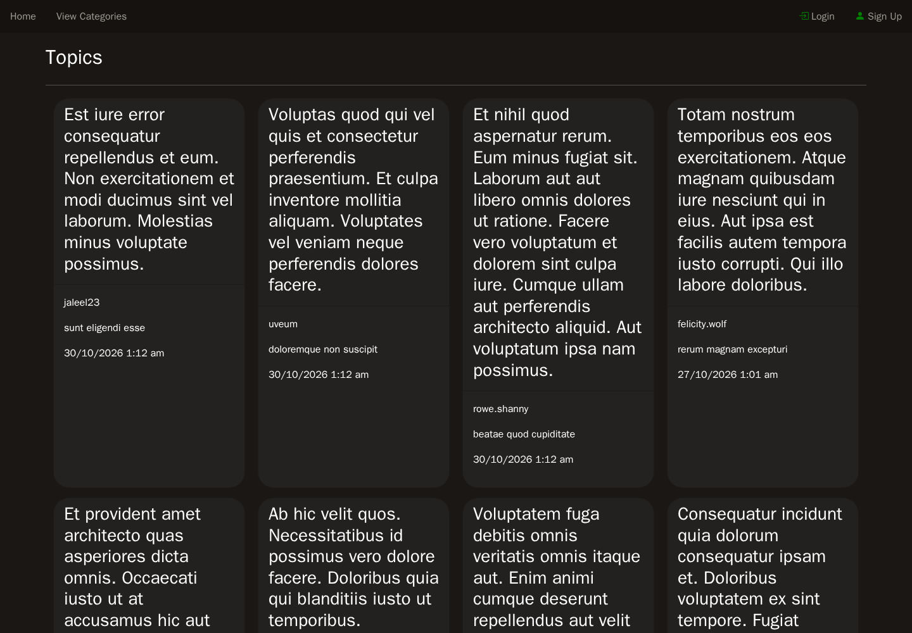
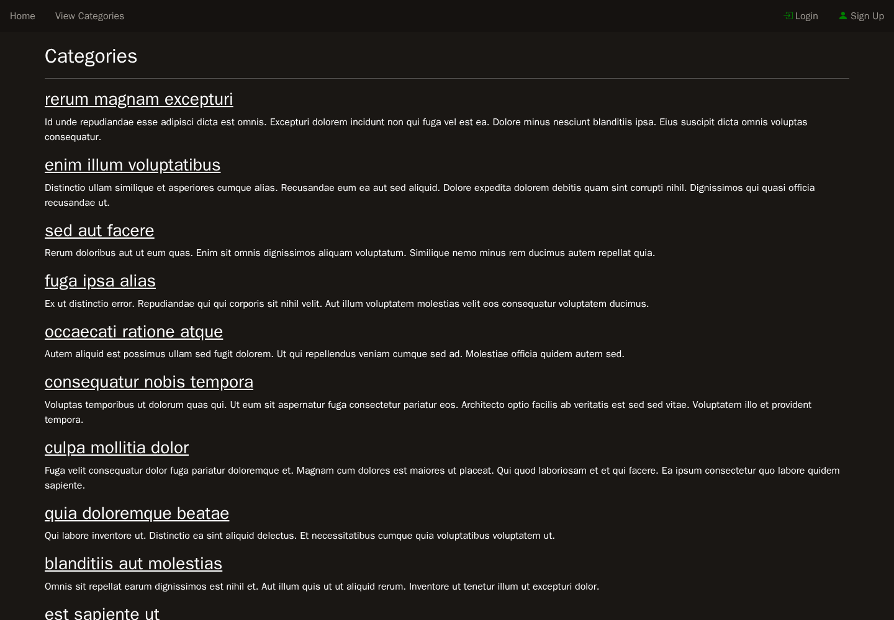
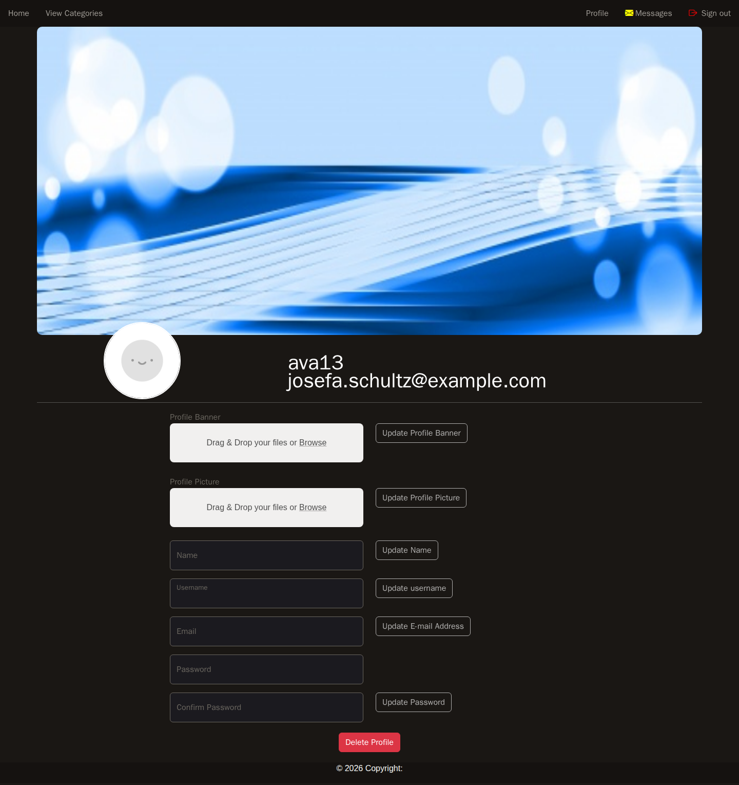

# Forum — Laravel · Inertia.js · Vue 3

A forum built with **Laravel 13**, **Inertia.js v3** and **Vue 3 (TypeScript)**. It is a refactoring of my university forum, which was originally built with vanilla PHP and vanilla JS.

## Tech Stack

| Layer | Technology |
| --- | --- |
| Backend | Laravel 13 (PHP 8.5), Eloquent, Sanctum API auth |
| Frontend framework | Inertia.js v3 + Vue 3 + TypeScript |
| Bundler | Vite (`@inertiajs/vite` plugin) |
| Styling | Bootstrap 5 + Bootstrap Icons |
| Real-time messaging | Laravel Reverb (WebSockets) + Laravel Echo |
| Image uploads | spatie/laravel-medialibrary + FilePond (avatar & banner) |
| Notifications | SweetAlert2 (`vue-sweetalert2`) modal toasts |
| URL generation in Vue | Ziggy |
| Testing | Pest (+ Playwright browser plugin) |

## Features

- **Sign up / login / logout** with session regeneration and CSRF protection
- **Posts** — create, edit and delete (author only), organised into categories
- **Comments** — create, edit and delete on any post (paginated, loaded lazily via Inertia deferred props)
- **Categories page** to browse topics by category; the home feed can be filtered by category
- **Public user profiles** (`/user/profile/{username}`) showing avatar, banner and that user's posts
- **Profile management** — update name, username, email and password, upload a profile picture and banner image (FilePond + Media Library), or delete your account entirely
- **Real-time private messaging** between users over Reverb WebSockets (`chat.{id}` private channels)
- **Inertia v3 conveniences** — deferred props with skeleton loading states, `once` props for data that never changes, and server-side pagination
- Standard Laravel protections throughout: FormRequest validation, authorisation checks (owner-only edits/deletes), CSRF tokens

## Pages & Screenshots

### Home / Topics feed

Paginated list of the latest posts. Can be filtered by category via query string.



### Categories

Browse all forum categories and their topics.



### Post view

A single post with its author, plus a paginated comments section that loads lazily (deferred prop).


### Create / edit post

The upsert form used for both creating new posts and editing your own.


### Public profile

A user's public page: avatar, banner, details and their posts (deferred).


### Edit profile

Update account details and upload a new profile picture or banner image via FilePond.



### Register

Guest registration form (also supports uploading an avatar on sign up).


The **login** page and the real-time **chats / messages** pages follow the same design language but have no committed screenshots.

## How to Run the Project

1. Copy `.env.example` to `.env`, run `php artisan key:generate`, and configure your database credentials and `APP_URL` (important — uploaded images are served through full URLs).
2. Install PHP dependencies: `composer install`
3. Install JS dependencies (the project uses pnpm): `pnpm install`
4. Run migrations and seeders: `php artisan migrate --seed`
5. Link the storage directory so uploaded media is publicly accessible: `php artisan storage:link`
6. Build or serve assets: `pnpm run dev` (development) or `pnpm run build` (production)
7. Serve the app: `php artisan serve`

### Real-time messaging setup

The chat feature broadcasts through Laravel Reverb. To enable live message delivery, create a Reverb application and set its credentials in `.env`:

```dotenv
BROADCAST_CONNECTION=reverb
REVERB_APP_KEY=...
REVERB_APP_SECRET=...
REVERB_APP_ID=...
REVERB_HOST=...
REVERB_PORT=443
REVERB_SCHEME=https
```

With the default `log` broadcast driver, messages are still stored and displayed on reload — they just aren't pushed in real time.

### Deploying with Kamal 2

Production deploys use [Kamal 2](https://kamal-deploy.org/) with the self-contained `production` stage in `docker/php/Dockerfile` (Nginx + PHP-FPM under Supervisord on port 80, healthcheck at `/up`, plus `worker`, `scheduler` and `reverb` roles). On container startup in production (`APP_ENV=production`), `docker/php/entrypoint.sh` automatically runs `php artisan migrate --force` before starting Supervisord or the role command, so schema migrations succeed before web traffic or queue workers start.

1. Copy `.kamal/secrets.example` to `.kamal/secrets` (gitignored and excluded by `.dockerignore`) and configure your registry token, `APP_KEY`, `APP_URL`, database credentials and Reverb / S3 settings.
2. Set the target host (`export KAMAL_DEPLOY_HOST=<server-ip>`) or update `config/deploy.yml`.
3. Bootstrap accessories and deploy on first run: `kamal setup` (starts PostgreSQL 18 and RustFS accessories, runs database migrations via the production entrypoint, and starts `web`, `worker`, `scheduler` and `reverb`).
4. (Optional) Seed initial forum categories on a fresh database: `kamal app exec -p "php artisan db:seed --force"`.
5. Deploy subsequent releases: `kamal deploy`

### Cloud PostgreSQL to PostgreSQL 18 (Kamal) Cutover Runbook

Live data currently lives in a cloud-hosted PostgreSQL instance (not on Kamal); there is no MySQL data anywhere in this stack. Moving it to the self-hosted PostgreSQL 18 accessory is a same-engine Postgres → Postgres migration, so `pg_dump`/`pg_restore` carries over the schema, data **and** sequence positions in one step. `config/deploy.yml`'s `QUEUE_CONNECTION: database` and the `jobs`/`cache`/`sessions` migrations are new **in this PR** — they describe the Kamal target this cutover moves to, not necessarily what today's cloud-hosted production is already running (`config/queue.php` defaults to `sync` when `QUEUE_CONNECTION` is unset, which is what staging currently uses). Follow this procedure:

1. **Stop producers, then drain the queue (write cutoff):**
   - Put the cloud-hosted application into maintenance mode (`php artisan down`) — this is the write cutoff and blocks new HTTP-triggered job dispatches.
   - Stop whatever dispatches scheduled jobs on the current production host — a cron entry running `artisan schedule:run`, a `schedule:work` process, or (only once production is already on Kamal) `kamal app stop --roles=scheduler` — so no more cron-dispatched jobs get enqueued.
   - Read `QUEUE_CONNECTION` (and, if set, the `REDIS_*` variables) from the **current production** `.env`, not from `config/deploy.yml`, since that file describes the post-cutover target. For `database` or `redis`, the standing worker process will not drain anything on its own here: `artisan queue:work` checks `isDownForMaintenance()` before popping each job and simply idles once `artisan down` has run, unless started with `--force` — and `config/deploy.yml`'s `worker` role cmd deliberately omits `--force`, so the already-running role process stalls the instant step 1 puts the app into maintenance mode. Drain with a one-off worker that ignores maintenance mode and exits on its own instead of relying on that process:
     - `sync`: nothing is queued — jobs run inline in the request that dispatched them, so there's nothing to drain.
     - `database`: run `php artisan queue:work database --force --stop-when-empty --tries=3 --backoff=3` (same queue options as the `worker` role cmd, plus `--force` to process despite maintenance mode and `--stop-when-empty` so it terminates once drained instead of looping forever). Ready, reserved **and** delayed jobs are all rows in one table, so confirm with a single count: `SELECT count(*) FROM jobs;` — it should be `0` once the one-off worker exits (allow for `retry_after` seconds on any job the worker had reserved when producers stopped; re-run the drain command if the count isn't `0` yet). Check `failed_jobs` too; anything there has already exhausted its retries and won't block the drain, but triage it before cutover.
     - `redis`: run `php artisan queue:work redis --force --stop-when-empty --tries=3 --backoff=3` the same way. There's no single table to confirm against — check all three key types per queue: `LLEN queues:<queue>` (ready), `ZCARD queues:<queue>:reserved` (reserved/in-flight) and `ZCARD queues:<queue>:delayed` (delayed), for every queue name the app dispatches to. Confirm all three are `0` for every queue once the one-off worker exits. Check `queues:<queue>:failed` the same way as `failed_jobs` above.
   - Only once the queue is confirmed drained, stop the standing worker process (`kamal app stop --roles=worker` once on Kamal, or the equivalent for however workers run today) — it has nothing left to pick up and would otherwise sit there idling against a maintenance-mode app until the deploy restarts it.
2. **Backup the cloud PostgreSQL database (recovery point):**
   - With the app quiesced (no process can write anymore), take a full custom-format dump: `pg_dump -Fc -h <cloud-host> -U laravel -d laravel -f forum-pre-cutover.dump`. Custom format carries the schema, data and current sequence values together.
   - Record source row counts per table for the verification step below: `SELECT relname, n_live_tup FROM pg_stat_user_tables ORDER BY relname;` (or `SELECT count(*) FROM <table>` per table if `n_live_tup` hasn't settled since the dump).
3. **Bootstrap PostgreSQL 18 & restore:**
   - Start the accessory on an empty volume: `kamal accessory boot postgres`.
   - Restore the full dump directly, **before running `php artisan migrate`**: `pg_restore --no-owner --no-privileges -h <kamal-host> -U laravel -d laravel forum-pre-cutover.dump`.
   - Why restore-first instead of migrate-then-data-only: the dump already matches exactly what the running app considers its current schema (including the `migrations` table), so restoring it first guarantees schema parity with no drift, and `pg_restore` sets every sequence to its dumped `last_value` automatically — no manual sequence reset is needed for the rows that came from the dump. The first production boot after this (see "Migrations" below) then only has to apply migrations that landed in this PR but hadn't been run against the cloud database yet, which is exactly what a normal `migrate --force` is for. Whether or not the cloud database (and therefore the dump) already had the `jobs`/`cache`/`sessions` tables from an earlier partial rollout, this is safe either way: those three migrations check `Schema::hasTable` before creating anything, so they no-op on tables the dump already restored instead of failing with "relation already exists".
4. **Verify row counts & sequences:**
   - Compare counts against the source recorded in step 2.
   - Confirm every sequence is still ahead of its table's own max `id` (defensive check — `pg_restore` should already guarantee this, but migrations applied in step 3 can add new sequences that only exist with their default starting value):
     ```sql
     DO $$
     DECLARE
         tbl text;
         seq text;
         max_id bigint;
     BEGIN
         FOREACH tbl IN ARRAY ARRAY['public.users', 'public.categories', 'public.posts', 'public.comments', 'public.chats', 'public.messages', 'public.media', 'public.temporary_files', 'public.replies', 'public.personal_access_tokens', 'public.failed_jobs', 'public.jobs']
         LOOP
             seq := pg_get_serial_sequence(tbl, 'id');
             IF seq IS NOT NULL THEN
                 EXECUTE format('SELECT COALESCE(MAX(id), 0) FROM %s', tbl) INTO max_id;
                 IF max_id = 0 THEN
                     PERFORM setval(seq, 1, false);
                 ELSE
                     PERFORM setval(seq, max_id, true);
                 END IF;
             END IF;
         END LOOP;
     END $$;
     ```
     This reads each table's **own** max `id` (the previous one-liner reused `MAX(id) FROM public.users` for every table, so any table whose max differed from `users` — e.g. `posts` — got its sequence reset to the wrong value and collided on the next insert) and is empty-table-safe (`setval(seq, 1, false)` makes the next value `1` instead of skipping it).
5. **Migrations & switch traffic:**
   - Deploy (`kamal deploy`). The production entrypoint gives the `web` role sole ownership of migrations and makes `worker`/`scheduler`/`reverb` wait for it before starting (see `docker/php/entrypoint.sh`), so this is safe to run with all four roles booting together; a role that's still waiting past the timeout exits non-zero instead of starting against a schema that isn't ready, so Kamal reports it as unhealthy rather than silently degraded.
   - Verify `GET /up` returns `200`, sign in, confirm the session persists across a request, and dispatch and consume a job to confirm the queue is live against the new database.
6. **Rollback limits:**
   - Keep the cloud PostgreSQL instance untouched (read-only, no traffic) until the cutover is signed off.
   - Before traffic is re-enabled against the new PostgreSQL 18 accessory, rollback is zero-loss: point the previous release back at the cloud PostgreSQL instance, which never received writes during the cutover window.
   - **Once live write traffic hits the new PostgreSQL 18 accessory, rolling back the application alone will not recover anything written there after the cutoff** — new accounts, posts, comments, messages and queued jobs. Reverting after that point means either accepting the pre-cutover dump as the recovery point (losing those writes) or exporting the new rows back to the cloud database during another maintenance window.
