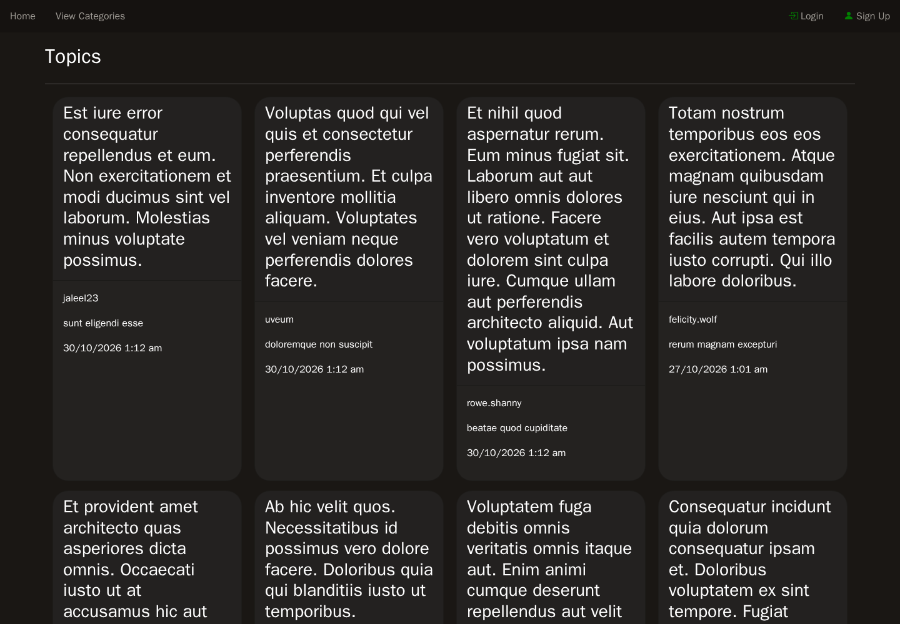
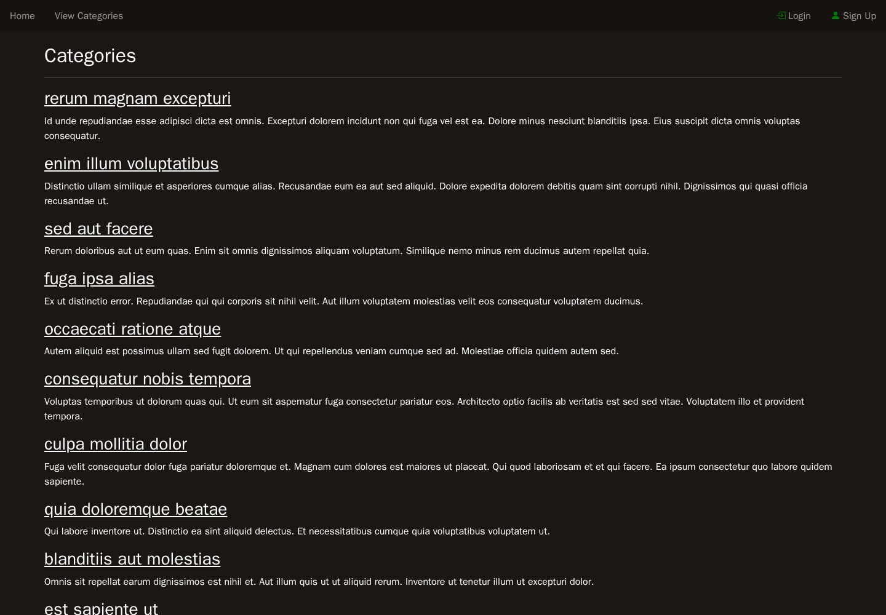
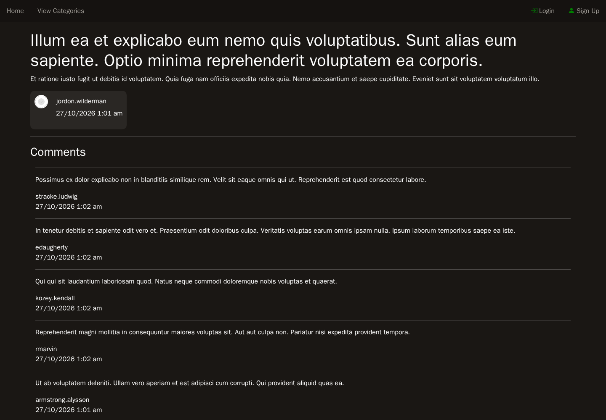
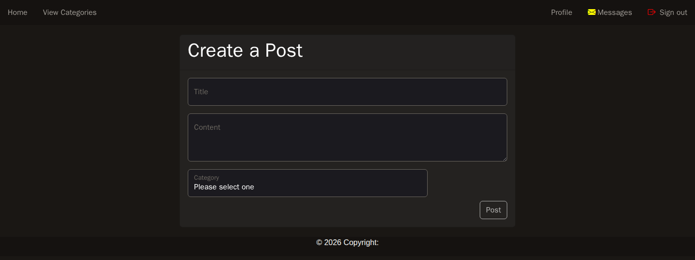
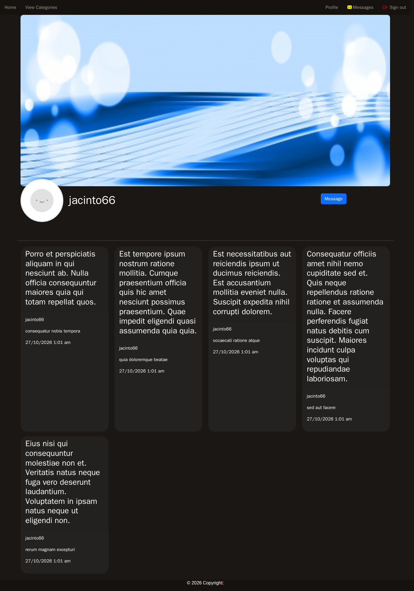
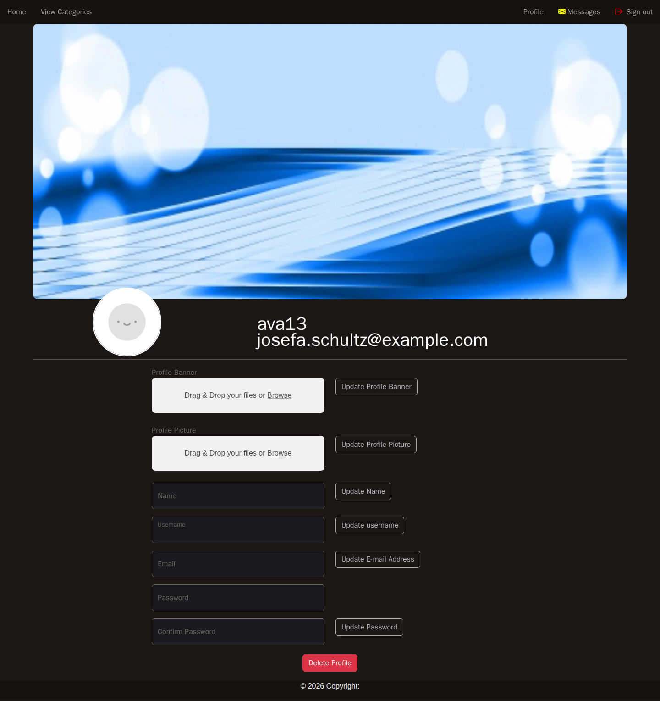
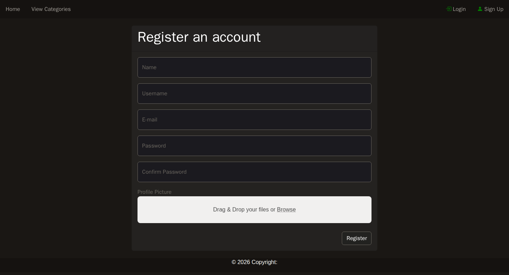

# Forum — Laravel · Inertia.js · Vue 3

A forum built with **Laravel 13**, **Inertia.js v3** and **Vue 3 (TypeScript)**. It is a refactoring of my university forum, which was originally built with vanilla PHP and vanilla JS.

## Tech Stack

| Layer | Technology |
| --- | --- |
| Backend | Laravel 13 (PHP 8.5), Eloquent, Sanctum API auth |
| Frontend framework | Inertia.js v3 + Vue 3 + TypeScript |
| Bundler | Vite (`@inertiajs/vite` plugin) |
| Styling | Bootstrap 5 + Bootstrap Icons |
| Real-time messaging | Laravel Reverb (WebSockets) + Laravel Echo |
| Image uploads | spatie/laravel-medialibrary + FilePond (avatar & banner) |
| Notifications | SweetAlert2 (`vue-sweetalert2`) modal toasts |
| URL generation in Vue | Ziggy |
| Testing | Pest (+ Playwright browser plugin) |

## Features

- **Sign up / login / logout** with session regeneration and CSRF protection
- **Posts** — create, edit and delete (author only), organised into categories
- **Comments** — create, edit and delete on any post (paginated, loaded lazily via Inertia deferred props)
- **Categories page** to browse topics by category; the home feed can be filtered by category
- **Public user profiles** (`/user/profile/{username}`) showing avatar, banner and that user's posts
- **Profile management** — update name, username, email and password, upload a profile picture and banner image (FilePond + Media Library), or delete your account entirely
- **Real-time private messaging** between users over Reverb WebSockets (`chat.{id}` private channels)
- **Inertia v3 conveniences** — deferred props with skeleton loading states, `once` props for data that never changes, and server-side pagination
- Standard Laravel protections throughout: FormRequest validation, authorisation checks (owner-only edits/deletes), CSRF tokens

## Pages & Screenshots

### Home / Topics feed

Paginated list of the latest posts. Can be filtered by category via query string.



### Categories

Browse all forum categories and their topics.



### Post view

A single post with its author, plus a paginated comments section that loads lazily (deferred prop).



### Create / edit post

The upsert form used for both creating new posts and editing your own.



### Public profile

A user's public page: avatar, banner, details and their posts (deferred).



### Edit profile

Update account details and upload a new profile picture or banner image via FilePond.



### Register

Guest registration form (also supports uploading an avatar on sign up).



The **login** page and the real-time **chats / messages** pages follow the same design language but have no committed screenshots.

## How to Run the Project

1. Copy `.env.example` to `.env`, run `php artisan key:generate`, and configure your database credentials and `APP_URL` (important — uploaded images are served through full URLs).
2. Install PHP dependencies: `composer install`
3. Install JS dependencies (the project uses pnpm): `pnpm install`
4. Run migrations and seeders: `php artisan migrate --seed`
5. Link the storage directory so uploaded media is publicly accessible: `php artisan storage:link`
6. Build or serve assets: `pnpm run dev` (development) or `pnpm run build` (production)
7. Serve the app: `php artisan serve`

### Real-time messaging setup

The chat feature broadcasts through Laravel Reverb. To enable live message delivery, create a Reverb application and set its credentials in `.env`:

```dotenv
BROADCAST_CONNECTION=reverb
REVERB_APP_KEY=...
REVERB_APP_SECRET=...
REVERB_APP_ID=...
REVERB_HOST=...
REVERB_PORT=443
REVERB_SCHEME=https
```

With the default `log` broadcast driver, messages are still stored and displayed on reload — they just aren't pushed in real time.
