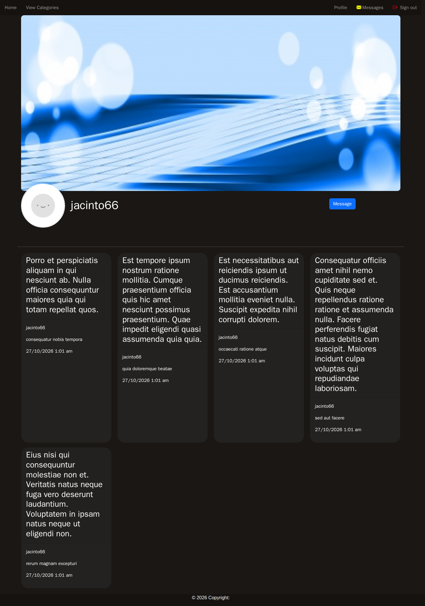

# Forum — Laravel · Inertia.js · Vue 3

A forum built with **Laravel 13**, **Inertia.js v3** and **Vue 3 (TypeScript)**. It is a refactoring of my university forum, which was originally built with vanilla PHP and vanilla JS.

## Tech Stack

| Layer | Technology |
| --- | --- |
| Backend | Laravel 13 (PHP 8.5), Eloquent, Sanctum API auth |
| Frontend framework | Inertia.js v3 + Vue 3 + TypeScript |
| Bundler | Vite (`@inertiajs/vite` plugin) |
| Styling | Bootstrap 5 + Bootstrap Icons |
| Real-time messaging | Laravel Reverb (WebSockets) + Laravel Echo |
| Image uploads | spatie/laravel-medialibrary + FilePond (avatar & banner) |
| Notifications | SweetAlert2 (`vue-sweetalert2`) modal toasts |
| URL generation in Vue | Ziggy |
| Testing | Pest (+ Playwright browser plugin) |

## Features

- **Sign up / login / logout** with session regeneration and CSRF protection
- **Posts** — create, edit and delete (author only), organised into categories
- **Comments** — create, edit and delete on any post (paginated, loaded lazily via Inertia deferred props)
- **Categories page** to browse topics by category; the home feed can be filtered by category
- **Public user profiles** (`/user/profile/{username}`) showing avatar, banner and that user's posts
- **Profile management** — update name, username, email and password, upload a profile picture and banner image (FilePond + Media Library), or delete your account entirely
- **Real-time private messaging** between users over Reverb WebSockets (`chat.{id}` private channels)
- **Inertia v3 conveniences** — deferred props with skeleton loading states, `once` props for data that never changes, and server-side pagination
- Standard Laravel protections throughout: FormRequest validation, authorisation checks (owner-only edits/deletes), CSRF tokens

## Pages & Screenshots

### Home / Topics feed

Paginated list of the latest posts. Can be filtered by category via query string.


### Categories

Browse all forum categories and their topics.


### Post view

A single post with its author, plus a paginated comments section that loads lazily (deferred prop).


### Create / edit post

The upsert form used for both creating new posts and editing your own.


### Public profile

A user's public page: avatar, banner, details and their posts (deferred).



### Edit profile

Update account details and upload a new profile picture or banner image via FilePond.


### Register

Guest registration form (also supports uploading an avatar on sign up).


The **login** page and the real-time **chats / messages** pages follow the same design language but have no committed screenshots.

## How to Run the Project

1. Copy `.env.example` to `.env`, run `php artisan key:generate`, set a non-empty `DB_PASSWORD` (required by `docker-compose.yml`, which binds PostgreSQL 18 to `127.0.0.1:${FORWARD_DB_PORT:-5432}:5432` with no default password), and configure your database credentials and `APP_URL` (important — uploaded images are served through full URLs).
2. Install PHP dependencies: `composer install`
3. Install JS dependencies (the project uses pnpm): `pnpm install`
4. Run migrations and seeders: `php artisan migrate --seed`
5. Link the storage directory so uploaded media is publicly accessible: `php artisan storage:link`
6. Build or serve assets: `pnpm run dev` (development) or `pnpm run build` (production)
7. Serve the app: `php artisan serve`

### Real-time messaging setup

The chat feature broadcasts through Laravel Reverb. To enable live message delivery, create a Reverb application and set its credentials in `.env`:

```dotenv
BROADCAST_CONNECTION=reverb
REVERB_APP_KEY=...
REVERB_APP_SECRET=...
REVERB_APP_ID=...
REVERB_HOST=...
REVERB_PORT=443
REVERB_SCHEME=https
```

With the default `log` broadcast driver, messages are still stored and displayed on reload — they just aren't pushed in real time.

The frontend (`resources/js/echo.ts`) also needs `VITE_REVERB_APP_KEY`, `VITE_REVERB_HOST`, `VITE_REVERB_PORT` and `VITE_REVERB_SCHEME`, which Vite inlines into the built JS at compile time rather than reading at runtime. In local dev, `pnpm run dev` reads these from `.env` like any other Vite env var. In the production image, they're passed as Docker build args from the same values as `REVERB_APP_KEY`/`HOST`/`PORT`/`SCHEME` (see `builder.args` in `config/deploy.yml`) - the app key is public by design, but `REVERB_APP_SECRET` must never be passed as a build arg.

`builder.args` and `servers.reverb.proxy.host` are ERB evaluated by the `kamal` CLI against the shell environment of whoever runs it - they do **not** read `.kamal/secrets.<destination>`. Before running `kamal build` or `kamal deploy`, export `REVERB_APP_KEY`, `REVERB_HOST`, `REVERB_PORT` and `REVERB_SCHEME` in that shell (e.g. `set -a; source .env.staging.deploy; set +a`). `REVERB_APP_KEY` and `REVERB_HOST` are validated with `require_env!` (checked in CI by `.kamal/validate_env.rb`) and raise `KeyError` (failing the build) if unset **or** blank/whitespace-only, rather than silently baking in an empty value; `REVERB_PORT` and `REVERB_SCHEME` default to `443`/`https` if omitted.

### Deploying staging and production on Unraid

Deploys use [Kamal 2](https://kamal-deploy.org/) with a shared base configuration in `config/deploy.yml` (`require_destination: true`) and per-destination overrides in `config/deploy.staging.yml` (`-d staging`) and `config/deploy.production.yml` (`-d production`). Both destinations deploy to the same Unraid server using the self-contained `production` stage in `docker/php/Dockerfile` (Nginx + PHP-FPM under Supervisord on port 80, healthcheck at `/up`, plus `worker`, `scheduler` and `reverb` roles). On container startup (`APP_ENV=production`), `docker/php/entrypoint.sh` runs `php artisan migrate:owned --force` so the `web` role holds the PostgreSQL advisory lock and finishes migrations before `worker`, `scheduler` and `reverb` start.

#### Architecture & Isolation on a Single Unraid Host

| Resource | Staging (`-d staging`) | Production (`-d production`) |
| --- | --- | --- |
| Kamal `service` / container prefix | `forum-staging` (`forum-staging-<role>-staging-<sha>`) | `forum` (`forum-<role>-production-<sha>`) |
| Container image (`image`) | `ghcr.io/sgb999/forum-laravel-inertia-vue-staging:<sha>` | `ghcr.io/sgb999/forum-laravel-inertia-vue-production:<sha>` |
| Secrets file (gitignored) | `.kamal/secrets.staging` (from `.kamal/secrets.staging.example`) | `.kamal/secrets.production` (from `.kamal/secrets.production.example`) |
| Persistent storage volume | `forum_staging_storage:/var/www/html/storage` | `forum_production_storage:/var/www/html/storage` |
| Shared Postgres 18 container (`DB_HOST`) | Connects to `forum-postgres:5432` on the `kamal` network (defines no accessories) | Owns accessory `forum-postgres` (`127.0.0.1:5432:5432`, cluster superuser `POSTGRES_USER=forum_admin`, `POSTGRES_DB=postgres`) and `forum-rustfs` (`127.0.0.1:9000:9000`) |
| Postgres database & non-superuser role | `DB_DATABASE=forum_staging`, `DB_USERNAME=forum_staging` (no superuser, no `CONNECT` on `forum_production`) | `DB_DATABASE=forum_production`, `DB_USERNAME=forum_production` (no superuser, no `CONNECT` on `forum_staging`) |
| RustFS S3 bucket (`AWS_BUCKET`) | Separate bucket & scoped credentials (`forum-staging`, `STAGING_AWS_ACCESS_KEY_ID`) | Separate bucket & scoped credentials (`forum-production`, `PRODUCTION_AWS_ACCESS_KEY_ID`; no fallback to `RUSTFS_ACCESS_KEY`) |
| Web host (`FORUM_HOST`) & edge port | Placeholder `staging.forum.example.com` (edge port `8082` -> `kamal-proxy`) | Placeholder `forum.example.com` (edge port `8081` -> `kamal-proxy`) |
| Reverb host (`REVERB_HOST`) & edge port | Placeholder `reverb-staging.forum.example.com` (edge port `8092` -> `kamal-proxy`) | Placeholder `reverb.forum.example.com` (edge port `8091` -> `kamal-proxy`) |

#### Port, `kamal-proxy`, and Reverb Public TLS Routing

- **No role-level container port publishing (zero-downtime rolling deploys):** Kamal starts each new `web` and `reverb` container and waits for its healthcheck to pass before stopping the old container. Because two containers on the same host cannot bind the same fixed host port simultaneously, neither `config/deploy.staging.yml` nor `config/deploy.production.yml` sets `options.publish` on `servers.web` or `servers.reverb`. All traffic to `web` (container port `80`) and `reverb` (container port `8080`) flows exclusively through the shared `kamal-proxy` container, routed by `Host` header (`proxy.host` and `servers.reverb.proxy.host`).
- **Environment ports at the proxy / Unraid edge:** Unraid's own web UI binds host ports `80` and `443`. `config/deploy.yml` configures `proxy.run` to publish `kamal-proxy` on `KAMAL_PROXY_HTTP_PORT` (default `8080`) and `KAMAL_PROXY_HTTPS_PORT` (default `8443`) so `80`/`443` are never touched. Separate port numbers for staging and production live at the Unraid external reverse proxy / edge listener (for example `8082` for staging web, `8092` for staging Reverb, `8081` for production web, and `8091` for production Reverb, or standard public TLS `443` per hostname), which forwards requests to `http://127.0.0.1:<KAMAL_PROXY_HTTP_PORT>` with the matching `Host` header (`FORUM_HOST` or `REVERB_HOST`).
- **Reverb public route:** `servers.reverb` runs on port `8080` in its own container and registers its own `kamal-proxy` route (`host: <%= require_env!("REVERB_HOST") %>`, `app_port: 8080`, `ssl: false`, `healthcheck.path: /up`), matching the `REVERB_HOST`/`VITE_REVERB_HOST` hostname that Laravel Echo (`resources/js/echo.ts`) connects to.
- **Unraid external reverse proxy / tunnel (Cloudflare Tunnel, Nginx Proxy Manager, SWAG, Caddy, or Traefik):** Terminate public TLS (`https` / `wss` on port `443`, matching `REVERB_PORT=443` and `REVERB_SCHEME=https`) or bind your per-environment edge ports (`8082`/`8092` staging, `8081`/`8091` production) for all four hostnames — staging web (`FORUM_HOST`), staging Reverb (`REVERB_HOST`), production web (`FORUM_HOST`), and production Reverb (`REVERB_HOST`) — and forward them over plain HTTP to `http://127.0.0.1:<KAMAL_PROXY_HTTP_PORT>` while preserving/setting the destination `Host` header. Enable **WebSockets support** (`Upgrade: websocket` and `Connection: Upgrade` headers) on both Reverb routes so browser WebSocket connections (`/app/*`) and Laravel's server-to-Reverb broadcast API requests (`/apps/*`) reach the Reverb container.

#### Exact Commands in Order

1. **First-time secrets & environment setup:**
   Copy both secrets templates to their gitignored destination files and fill in your real credentials:
   ```bash
   cp .kamal/secrets.staging.example .kamal/secrets.staging
   cp .kamal/secrets.production.example .kamal/secrets.production
   ```
   Supply your real values for:
   - **Host & proxy ports (shell env):** `KAMAL_DEPLOY_HOST`, and optionally `KAMAL_PROXY_HTTP_PORT` (default `8080`) and `KAMAL_PROXY_HTTPS_PORT` (default `8443`).
   - **Per-destination shell env (exported before each build/deploy):** `FORUM_HOST`, `REVERB_HOST`, `REVERB_APP_KEY`, `REVERB_PORT` (default `443`), and `REVERB_SCHEME` (default `https`).
   - **Accessory admin & bootstrap secrets (`.kamal/secrets.production` only):** `POSTGRES_PASSWORD` (for the `POSTGRES_USER=forum_admin` PostgreSQL superuser; must be distinct from `DB_PASSWORD`), `PRODUCTION_DB_PASSWORD`, and `STAGING_DB_PASSWORD` (injected into the `forum-postgres` accessory container via `accessories.postgres.env.secret` so `/usr/local/bin/init-staging.sh` reads them from the container environment rather than the `kamal accessory exec` command line), plus `RUSTFS_ACCESS_KEY` and `RUSTFS_SECRET_KEY` (for the `forum-rustfs` accessory admin; must be distinct from the app's bucket-scoped `AWS_ACCESS_KEY_ID` / `AWS_SECRET_ACCESS_KEY`).
   - **Per-destination app secrets (distinct values in `.kamal/secrets.staging` vs `.kamal/secrets.production`):** `KAMAL_REGISTRY_PASSWORD`, `APP_KEY`, `APP_URL`, `DB_PASSWORD` (for the non-superuser `forum_staging` and `forum_production` roles), `REVERB_APP_ID`, `REVERB_APP_KEY`, `REVERB_APP_SECRET`, `REVERB_HOST`, `AWS_ACCESS_KEY_ID`, `AWS_SECRET_ACCESS_KEY` (scoped to each destination's own bucket), `AWS_BUCKET` (`forum-staging` vs `forum-production`), and `AWS_ENDPOINT` (default `http://forum-rustfs:9000`).

2. **Bootstrap the shared PostgreSQL 18 & RustFS accessories and initialize both non-superuser roles/DBs:**
   Boot the accessories (owned by the `production` destination) and run the mounted idempotent init script (`docker/postgres/init-staging.sh`). The script reads `PRODUCTION_DB_PASSWORD` and `STAGING_DB_PASSWORD` directly from the accessory container environment (populated from `.kamal/secrets.production` via `accessories.postgres.env.secret` and read inside `psql` via `\getenv`) so neither password ever appears on a command line or in Kamal's host audit log:
   ```bash
   export KAMAL_DEPLOY_HOST=<unraid-lan-ip>
   export REVERB_APP_KEY=<production-reverb-app-key>
   export REVERB_HOST=<reverb.your-domain.tld>

   kamal accessory boot all -d production
   kamal accessory exec postgres -d production --reuse "/usr/local/bin/init-staging.sh"
   ```
   *(Create the `forum-staging` and `forum-production` buckets and per-bucket scoped access keys in the RustFS console before deploying).*

3. **Deploy staging (`-d staging`):**
   Export the staging build/routing variables and deploy (builds and pushes `ghcr.io/sgb999/forum-laravel-inertia-vue-staging:<sha>` with staging's Vite Reverb config):
   ```bash
   export KAMAL_DEPLOY_HOST=<unraid-lan-ip>
   export FORUM_HOST=<staging.your-domain.tld>
   export REVERB_HOST=<reverb-staging.your-domain.tld>
   export REVERB_APP_KEY=<staging-reverb-app-key>
   export REVERB_PORT=443
   export REVERB_SCHEME=https

   kamal setup -d staging
   # (Optional) Seed initial forum categories on a fresh staging database:
   kamal app exec -d staging -p "php artisan db:seed --force"
   # Subsequent staging releases:
   kamal deploy -d staging
   ```

4. **Verify staging (rollout checklist) before touching production:**
   Keep the previous deployment and database available until all five checks pass on staging:
   - [ ] **All four roles start:** `kamal app details -d staging` shows `web`, `worker`, `scheduler`, and `reverb` running and healthy on `forum_staging`.
   - [ ] **Login persists:** Sign in via the browser and reload/navigate across pages to confirm database-backed sessions (`sessions` table) persist.
   - [ ] **Queued job completes:** Trigger or dispatch a queued job and confirm `worker` consumes it from the `jobs` table with `0` rows added to `failed_jobs`.
   - [ ] **Upload survives a redeploy:** Upload an avatar or banner image, run `kamal deploy -d staging`, and confirm the uploaded image still loads after the new containers replace the old ones.
   - [ ] **Live chat delivery works end-to-end:** Open a chat between two signed-in users in two separate browser sessions, send a message in one browser, and confirm it appears in the second authorized browser in real time without a page refresh.

5. **Deploy production (`-d production`):**
   Once the staging checklist passes, export the production build/routing variables and deploy production (builds and pushes `ghcr.io/sgb999/forum-laravel-inertia-vue-production:<sha>` with production's Vite Reverb config):
   ```bash
   export KAMAL_DEPLOY_HOST=<unraid-lan-ip>
   export FORUM_HOST=<forum.your-domain.tld>
   export REVERB_HOST=<reverb.your-domain.tld>
   export REVERB_APP_KEY=<production-reverb-app-key>
   export REVERB_PORT=443
   export REVERB_SCHEME=https

   kamal deploy -d production
   # (Optional) Seed initial forum categories on a fresh production database:
   kamal app exec -d production -p "php artisan db:seed --force"
   ```

This is a portfolio project with no real production data: the Kamal PostgreSQL accessory starts empty and is filled by migrations (and the optional seeder above), same as any other fresh deploy. Once the new site is confirmed up and the staging/production rollout checklist passes, the old cloud-hosted database can simply be retired.
